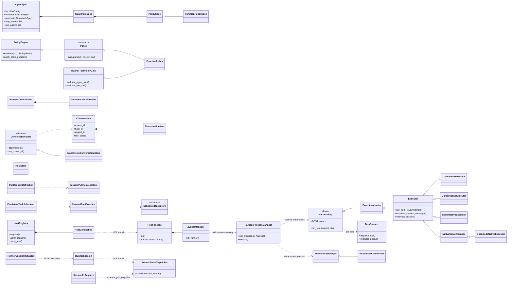
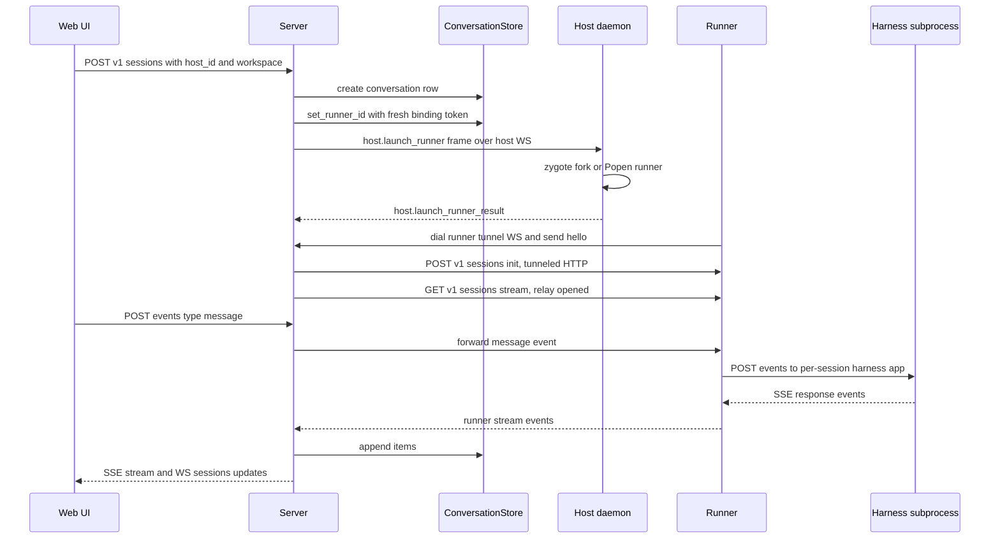
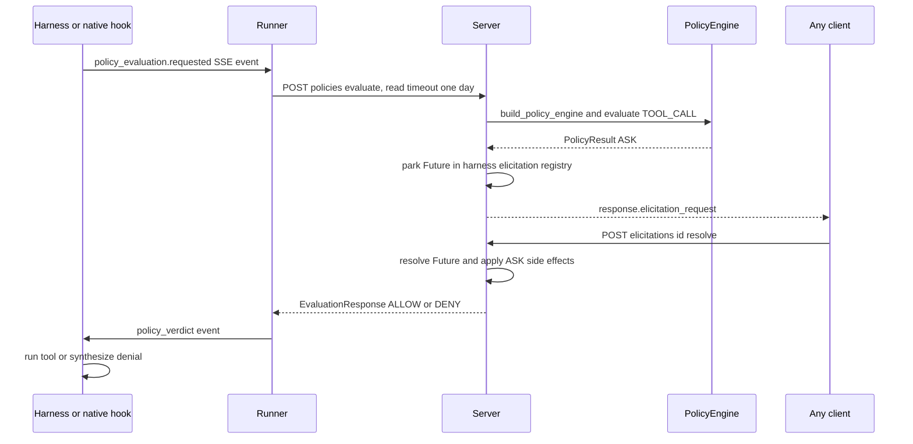
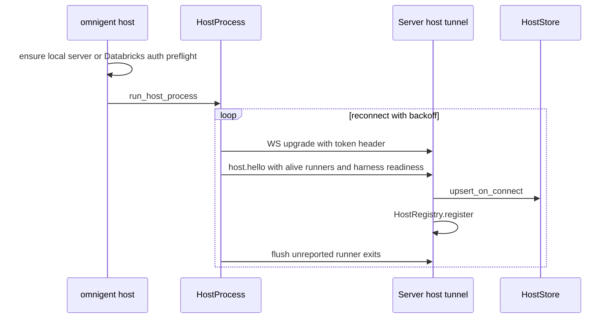
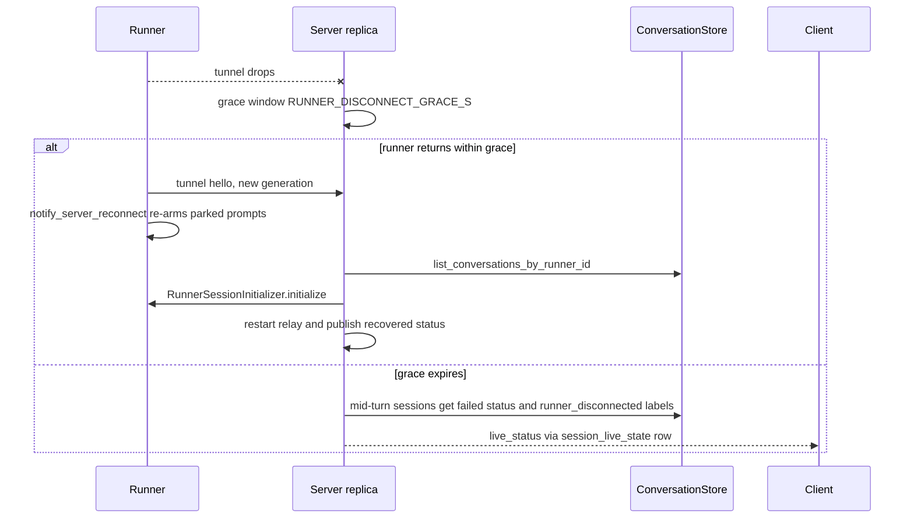
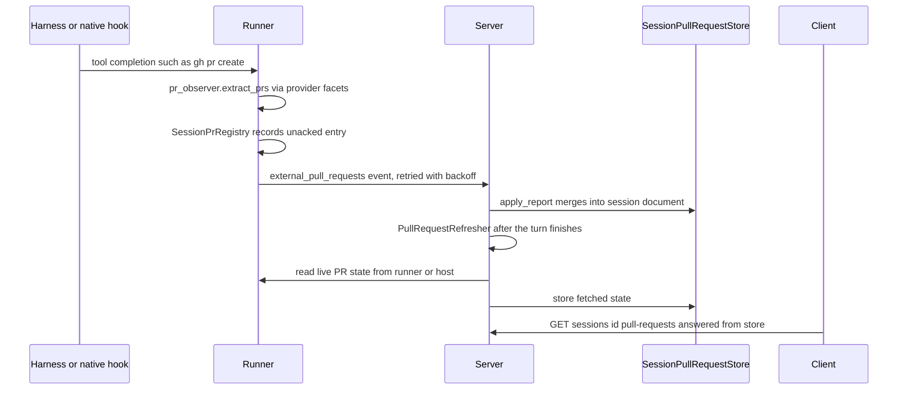

# Omnigent Class Map + Workflow Traces — Research Report (2026-11-09 update)
> Produced 2026-11-09 by a read-only Claude research subagent (one of five parallel passes) updating the 2026-08-18 report. Method: read current code at commit b03ad1ac9, compared against the baseline report. Citations are file:line at that commit.

Scope note: the baseline (`docs/research/2026-08-18-class-map-workflows.md`) described code at about commit `8513d884e` (2026-07-14); this pass covers the 4,799 commits since then. All paths are relative to `omnigent/` unless they start with `docs/` or `designs/`. Labels: **NEW** means the code didn't exist at baseline. **CHANGED** means the code existed but behaves differently now. **UNCHANGED** means the same design, with line numbers moved. **GAP-FILLED** means the code existed at baseline but the baseline missed it.

## 0. Biggest structural deltas vs baseline

1. **The harness boundary is a real class, and it's a process boundary (GAP-FILLED).** `HarnessApp` (`runtime/harnesses/_scaffold.py:845`) is the base class for one FastAPI app per session. It runs in its own subprocess (`runtime/harnesses/_runner.py:438 main`) and is spawned by `HarnessProcessManager` (`runtime/harnesses/process_manager.py:560`). `ExecutorAdapter(HarnessApp)` (`runtime/harnesses/_executor_adapter.py:185`) wraps an `Executor`. Every `*_harness.py` is just `create_app()` returning `ExecutorAdapter(executor_factory=...)`, for example `inner/claude_sdk_harness.py:330-345`. The file dates from the 2026-06-13 import, so the baseline's "no Harness base class" was a gap in that report, not a later refactor.
2. **Harness registry is plugin-driven (NEW/CHANGED).** `HarnessContribution` / `NativeHarnessProvider` / `HarnessPluginState` (`harness_plugins.py:84-142`) declare harness modules, aliases, install specs, spawn-env builders and capabilities as dotted-import *strings*. `native/native_dispatch.py:29-59` resolves them lazily at dispatch time.
3. **Policy ASK moved to the server (CHANGED, the headline change).** Harnesses, native hooks and the runner proxy all `POST /v1/sessions/{id}/policies/evaluate` (`server/routes/sessions/routes_hooks.py:767`). The server builds a `PolicyEngine` and, on ASK, **holds the HTTP request open** in `_hold_native_ask_gate_impl` (`server/routes/_sessions/orchestration.py:2655`) until a human decides. The runner-side `pending_approvals.wait_for_user_approval` (`runner/pending_approvals.py:332`) has **no callers left**, and `RunnerToolPolicyGate` survives mainly for `evaluate_agent_start` (`runner/app.py:9395-9399`).
4. **Runner↔server is HTTP-over-WebSocket with an acked event channel (NEW).** The runner dials `/v1/runners/{runner_id}/tunnel` (`server/routes/runner_tunnel.py:430`). The server's runner HTTP calls are dispatched into the runner's ASGI app over that socket (`runner/transports/ws_tunnel/serve.py:216 dispatch_via_asgi`). Upward transcript events travel as `EventBatchFrame`s and are acknowledged with `EventAckFrame`s (`runner/transports/ws_tunnel/event_delivery.py:47 RunnerEventDispatcher`).
5. **Host gained a runner zygote, host-side persistence and a large frame vocabulary (NEW).** `ZygoteManager.fork_runner` (`host/runner_zygote.py:164,298`, added 2026-08-04) forks runners copy-on-write. `HostStore` (`stores/host_store.py:294`) persists hosts. `host/frames.py` grew from about 14 to more than 60 frame types (`:215-1498`): harness install/login/logout, secrets, fs read/write, MCP/skills/plugins inventory, local-session import.
6. **New domain aggregates:** Projects (`entities/project.py:17`), Automations / scheduled tasks (`entities/scheduled_task.py:41`, `server/scheduled/`), PRs linked to sessions (`runner/session_prs.py`, `stores/session_pull_request_store.py:375`, added 2026-09-10 and 2026-10-27), live-state replication across replicas (`server/session_live_state.py`), and smart turn routing (`runner/turn_routing.py:723 TurnRouter`).

## 1. Class / module map

Key locations, grouped by process:

- **Spec/policy (shared lib):** `AgentSpec` spec/types.py:1473 · `GuardrailsSpec` :1449 · `PolicySpec`/`FunctionPolicySpec` :1377/:1423 · `Policy` policies/base.py:31 · `FunctionPolicy` policies/function.py:76 · `EvaluationContext`/`PolicyResult`/`ElicitationRequest` policies/types.py:84/239/320 · `PolicyEngine` runtime/policies/engine.py:44 (`evaluate` :243, `_evaluate_composed` :302) · `build_policy_engine` runtime/policies/builder.py:517.
- **Server process:** `create_session` server/routes/sessions/routes_core.py:1068 · `post_event` server/routes/sessions/routes_events.py:1061 / `_post_event_impl` :1216 / `ingest_runner_batch` :1125 · `HostRegistry` server/host_registry.py:607 (`HostConnection` :382, `RunnerExitReports` :269) · `RunnerSessionInitializer` server/runner_session_init.py:87 · `RunnerRouter` runner/routing.py:156 (used server-side) · `PolicyEngine` built per evaluation · `PullRequestRefresher` server/session_pull_requests.py:274 · `PersistentTaskScheduler` server/scheduled/dispatch_scheduler.py:418, `ClaimedRunExecutor` server/scheduled/fire.py:2636 · `session_stream.publish` runtime/session_stream.py:354 (in-process pub-sub, no replay).
- **Stores (server DB):** `ConversationStore(ABC)` stores/conversation_store/__init__.py:470 (`append` with idempotent `stable_id` :893) · `SqlAlchemyConversationStore` sqlalchemy_store.py:913 · `HostStore` stores/host_store.py:294 · `SessionPullRequestStore` stores/session_pull_request_store.py:375 · `ScheduledTaskStore(ABC)` stores/scheduled_task_store/__init__.py:38.
- **Host daemon:** `HostProcess` host/connect.py:1279 (`run` :4934, `_connect_and_serve` :5284, `_serve_frames` :5606, `_handle_launch_impl` :2041, `_spawn_runner_proc` :2364, `_watch_runner` :2710) · `ZygoteManager` host/runner_zygote.py:164.
- **Runner process:** `create_app` runner/_entry.py:1540, `_run_tunnel_from_env` :1871 · `serve_tunnel` runner/transports/ws_tunnel/serve.py:361 · `RunnerEventDispatcher` event_delivery.py:47 · `post_session_events` runner/app.py:7205 · `_stream_message_to_harness` :6145 · `HarnessProcessManager` runtime/harnesses/process_manager.py:560 · `RunnerMcpManager` runner/mcp_manager.py:241 / `ProxyMcpManager` runner/proxy_mcp_manager.py:141 · `SessionPrRegistry` runner/session_prs.py:77 · `TurnRouter` runner/turn_routing.py:723. The runner is **still a closure-heavy FastAPI module**: `runner/app.py` is 9,451 lines with routes as nested functions and no `Runner` class (UNCHANGED).
- **Harness subprocess:** `HarnessApp` runtime/harnesses/_scaffold.py:845 (`TurnContext` :424, events route :1137) · `ExecutorAdapter` _executor_adapter.py:185 (`run_turn` :239) · `Executor` inner/executor.py:657 (`run_turn` :663) · 26 `Executor` subclasses, for example `ClaudeSDKExecutor` inner/claude_sdk_executor.py:1872 · `NativeServerHarness(Executor)` native/native_server_harness.py:46.

## 2. Workflow traces

### W1. New session from web UI → server → host → runner → harness → transcript back — CHANGED

1. `create_session` (server/routes/sessions/routes_core.py:1068) validates the request. It then creates the row through `_create_session_from_existing_agent` (server/routes/_sessions/orchestration.py:11633) and accepts any initial input (`_accept_initial_input`, routes_core.py:491).
2. For a caller-chosen host, `_bind_and_launch_on_caller_host` (routes_core.py:828) authorizes through `resolve_host_launch` (server/routes/_host_launch.py:213). **NEW:** managed (sandbox) hosts instead go through a background `_schedule_managed_launch`.
3. `_launch_runner_on_host_locked` (server/routes/_sessions/helpers.py:6488) calls `HostRegistry.admit_launch` (host_registry.py:908). It mints `binding_token` and `token_bound_runner_id` and writes the binding (`ConversationStore.set_runner_id`, sqlalchemy_store via __init__.py:1657). It then sends `HostLaunchRunnerFrame` via `HostRegistry.send_text` (:928) and awaits the result with a timeout.
4. On the host, `HostProcess._handle_launch_impl` (host/connect.py:2041) checks `harness_is_configured`, recreates a missing workspace leaf, and calls `_spawn_runner_proc` (:2364). That goes through the **zygote** `ZygoteManager.fork_runner` (host/runner_zygote.py:298, **NEW**) and falls back to `Popen`. It returns `HostLaunchRunnerResultFrame` (:2041+246).
5. The runner boots (`runner/_entry.py:1540 create_app`, `:1871 _run_tunnel_from_env`) and `serve_tunnel` dials `/v1/runners/{id}/tunnel` with hello (serve.py:361, `_send_hello` :1490). The server registers a `RunnerSession` (runner_tunnel.py:430) and fires `_on_runner_connect` (server/app.py:4562).
6. `_on_runner_connect` lists `list_conversations_by_runner_id`, calls `RunnerSessionInitializer.initialize` (runner_session_init.py:181, which POSTs runner `/v1/sessions`, runner/app.py:3496, **NEW** generation-tracked class), and starts `_ensure_runner_relay` (orchestration.py:10170). That relay is `_relay_runner_stream`, which consumes runner `GET /v1/sessions/{id}/stream` (runner/app.py:3541).
7. User message: `post_event` (routes_events.py:1061) → `_post_event_impl` (:1216) → `_dispatch_session_event_to_runner_impl` (orchestration.py:8165) → runner `post_session_events` (runner/app.py:7205) → `_stream_message_to_harness` (:6145).
8. `HarnessProcessManager.get_client` (process_manager.py:726) spawns or reuses the **per-session harness subprocess** over UDS. The runner POSTs to `HarnessApp`'s events route (_scaffold.py:1137). `ExecutorAdapter.run_turn` (_executor_adapter.py:239) drives `Executor.run_turn` (inner/executor.py:663).
9. Transcript back, **two paths (CHANGED)**. (a) SDK harnesses: harness SSE → runner stream → server relay (orchestration.py:9296) persists items and publishes to `session_stream` (runtime/session_stream.py:354). (b) Native harnesses (Claude Code, Codex in tmux): a *forwarder* tails the vendor's own JSONL transcript (`forward_claude_transcript_to_session`, harnesses/claude_native/forwarder.py:1283) and posts `external_conversation_item` events carrying `source_id`. These go through `RunnerEventDispatcher` as `EventBatchFrame`s (event_delivery.py:148) → `ingest_runner_batch` (routes_events.py:1125) → `ConversationStore.append` with idempotent `stable_id` (__init__.py:893). The forwarder advances its on-disk cursor only after the ack (event_delivery.py:47-52).
10. Clients receive `GET /v1/sessions/{id}/stream` SSE (routes_events.py:3877) plus the sidebar `WS /v1/sessions/updates` (routes_core.py:2594).

### W2. Tool call with policy ASK approval — CHANGED (server-held gate)

1. SDK path: the executor's policy callback → `ExecutorAdapter._stable_policy_evaluator` (_executor_adapter.py:1034) → `TurnContext.evaluate_policy` (_scaffold.py:724). That emits a `policy_evaluation.requested` SSE event (:763), which fails closed if no turn context exists.
2. The runner sees the event in its stream loop (runner/app.py:6954-6965) and spawns `_evaluate_policy_via_omnigent` (runner/policy_proxy.py:52). That POSTs `/v1/sessions/{id}/policies/evaluate` (:116) with an 86,400 s read timeout (:32) so a parked ASK isn't cut off.
3. Native path: Claude Code / Codex `PreToolUse` and `UserPromptSubmit` hooks (native/native_policy_hook.py:137) call the same endpoint directly, as do `inner/cursor_policy_hook.py:77` and `inner/hermes_policy_hook.py:100`.
4. The server's `evaluate_policy` (routes_hooks.py:775) builds the engine (`build_policy_engine`, :1050). On ASK for TOOL_CALL/REQUEST it calls `_hold_native_ask_gate` (:1129) → `_hold_native_ask_gate_impl` (orchestration.py:2655) → `_publish_and_wait_for_harness_elicitation` (:473), which parks a Future in `_harness_elicitation_registry` (server/_elicitation_registry.py:21, workspace-scoped).
5. A human resolves via `POST /sessions/{id}/elicitations/{eid}/resolve` (routes_elicitations.py:75,83) → `_resolve_elicitation` (orchestration.py:2401). That sets the Future and still forwards to the runner for any runner-parked MCP elicitation (`ProxyMcpManager` → `pending_approvals.wait_for_user_verdict`, proxy_mcp_manager.py:578). Approved side effects are applied by `_apply_pending_policy_ask_writes`, following POLICIES.md §7.2.
6. The verdict collapses to a hard ALLOW/DENY. A stray ASK reaching a hook fails closed as `deny` instead of the old `defer`, so permissive `permission_mode`s can't bypass it (native_policy_hook.py:370-460). DENY is rendered with `format_deny_text` (runner/policy.py:485).
7. **Removed vs baseline:** the runner-local ASK park (`wait_for_user_approval`) and the claim that "the runner fast-paths ALLOW/DENY". Today every TOOL_CALL evaluation is a server round-trip.

### W3. Host init / auth / reconnect — UNCHANGED design, CHANGED surface

1. `host()` (cli.py:9853) is still the foreground daemon. **NEW:** `omnigent host enable|disable` installs a per-user OS service (host/service.py, host/daemon_lifecycle.py), and a daemon-record claim prevents two daemons for the same workspace (cli.py:9853+95-132). It calls `ensure_local_omnigent_server` (+91) or `_ensure_databricks_server_auth` (+116), then `run_host_process` (host/connect.py:6159).
2. `HostProcess.run` (connect.py:4934) loops `_connect_and_serve` (:5284). Backoff is exponential with jitter (:4934+223); 1001/1012 recycles get a fast retry (+174); a login-redirect streak becomes a permanent `HostConnectError` (+88-115). **NEW:** wake-from-sleep detection force-drops half-open sockets (+43, :4934+301).
3. `_serve_frames` (:5606) sends `HostHelloFrame` (frames.py:285) and flushes `_unreported_exits` (+52).
4. Server `tunnel` (host_tunnel.py:225) authenticates, then on hello calls **`HostStore.upsert_on_connect`** (+426, **NEW**: host rows are now durable, with `set_offline`/`heartbeat` at :631/:1343), then `HostRegistry.register` (:441).

### W4. Reconnect / offline (runner tunnel or server restart) — CHANGED

1. `_relay_runner_stream` (orchestration.py:9013) rides out transport drops within `RUNNER_DISCONNECT_GRACE_S`. After the grace, only sessions that were mid-turn are failed (`_runner_disconnect_requires_failure`); idle sessions just show offline. **NEW:** if the server itself is shutting down, no session is failed (`server_shutting_down`).
2. `_on_runner_disconnect` (server/app.py:4416) marks the binding. `_on_runner_connect` (:4562) re-derives everything from the DB row (`list_conversations_by_runner_id`, :4598), re-inits through `RunnerSessionInitializer` (:4830) and publishes recovery (:4846). This is the baseline's "DB row is truth" conclusion, still valid.
3. **NEW, runner side:** `_catch_up_scan` (runner/app.py:8628) calls `pending_approvals.notify_server_reconnect` (:8632, defined in runner/pending_approvals.py:190). That bumps a server generation so waits that opted in re-issue policy checks or re-publish prompts the new server replica never saw.
4. **NEW, event replay:** unacked `EventBatchFrame`s stay queued in `RunnerEventDispatcher` and are retransmitted on the next ready tunnel generation (event_delivery.py:47-52, `_worker` :180). The server dedups by `stable_id`.
5. **NEW, cross-replica display state:** `session_live_state` writes `runner_online`/status/pending-approval count to the `conversations` row, best-effort and ordered, so any replica can serve the sidebar under host_id replica sharding (server/session_live_state.py:1-30). Host-runner exit reporting (`HostRunnerExitedFrame`, frames.py:470, and `RunnerExitReports`, host_registry.py:269) is UNCHANGED.

### W5. Message queue / steer — UNCHANGED design, line numbers moved

1. Client-side pre-POST queue, auto-flush on idle, Steer = POST now (docs/QUEUE_STEER_DESIGN.md:23-60, last touched 2026-11-01).
2. The server forwards through `_dispatch_session_event_to_runner_impl` (orchestration.py:8165). **NEW:** for native terminal sessions, `runtime/pending_inputs.py` keeps the "queued bubble" server-side until the transcript forwarder echoes the user message back.
3. On the runner, a message for an in-flight turn is injected over HTTP (runner/app.py:7463). The harness side treats a `message` whose `previous_response_id` equals the in-flight turn as an injection (_scaffold.py:22,669). `ExecutorAdapter._watch_injections` (_executor_adapter.py:723) then calls `Executor.enqueue_session_message` (:762, base no-op at inner/executor.py:720).

### W6. PR linked to a session — NEW (2026-09-10 → 2026-10-27)

1. Detection: `observe_tool_completion` (runner/pr_observer.py:540) is called from `ExecutorAdapter` for SDK harnesses (_executor_adapter.py:1177). Native Claude hooks reach it through `observe_hook` (pr_observer.py:601, called from harnesses/claude_native/bridge.py:8244).
2. `extract_prs` (:446) parses shell commands, including heredocs and nested shells, and MCP results through per-provider `PullRequestFacet`s (`_facets` :379; GitHub/GitLab/Azure DevOps under runner/git_providers/).
3. `SessionPrRegistry` (runner/session_prs.py:77) keeps unacknowledged entries. `PullRequestReporter` (runner/pr_reports.py, installed at runner/_entry.py:1815) sends `external_pull_requests` (pr_reports.py:26), clearing entries only on 2xx and backing off from 5 s to 300 s (:29-30). The docstring is explicit (pr_reports.py:1-9): "The server owns which PRs belong to a session."
4. The server routes the event type through `_RUNNER_EVENT_TYPES` (routes_events.py:876-884) → `_store_reported_pull_requests` (:1200) → `SessionPullRequestStore.apply_report` (stores/session_pull_request_store.py:512).
5. `PullRequestRefresher` (server/session_pull_requests.py:274), bound at routes_resources.py:3502, refreshes after turn end and at most once per `FRESHNESS_S`. `GET /sessions/{id}/pull-requests` (routes_resources.py:3504) "never contacts the runner or host" (:3514), so it answers while both are offline.

## 3. One authoritative node, many projections?

**Mostly yes. The authoritative node is the server's relational DB, behind `ConversationStore` / `HostStore` / `SessionPullRequestStore` / `ScheduledTaskStore`. There's one caveat: for native harnesses, the content originates upstream in a vendor-owned file.**

| Layer | Role | Sync direction / mechanism |
|---|---|---|
| Server DB: `conversations`, `conversation_items` (server/DBSPEC.md), hosts, session PR documents, scheduled tasks, projects | **System of record** for session identity, runner/host binding, transcript, labels, approvals' side effects, PR links, automations | Written only by server routes. Everything else re-derives from it. `_on_runner_connect` rebuilds bindings from `list_conversations_by_runner_id` |
| Vendor transcript on host disk, e.g. `~/.claude/projects/.../<session>.jsonl` | **Upstream source of content** for native sessions, not authoritative for Omnigent metadata | One-way **pull→push**: forwarder tails file → `EventBatchFrame` → ack → cursor advance. Idempotent through `stable_id`/`source_id` |
| Runner in-memory state (`_session_spec_cache`, histories, `SessionPrRegistry`, `RunnerEventDispatcher` queue) | **Cache plus outbox** | Downward: session-init POST from the server. Upward: acked outbox, re-armed on reconnect generation |
| Harness subprocess state (`TurnContext` futures) | Ephemeral per-turn projection | Request/response over UDS HTTP plus SSE. Lost on crash, recovered by replaying history from server |
| `session_stream` / `user_session_stream` (in-process pub-sub) | **Live projection, no replay** | Fan-out on publish. Clients recover by `GET /v1/sessions/{id}` snapshot plus dedup by item id (runtime/session_stream.py:1-25) |
| `session_live_state` columns on `conversations` | Display projection for other replicas | Best-effort, ordered async write from the tunnel-holding replica's in-memory caches |
| `HostRegistry` / runner tunnel registry / elicitation Future registries | Per-replica live connection state | Re-derived on reconnect, never authoritative |
| Web UI localStorage queue | Client-only drafts, not in the system | Promoted to server state only on POST |

Commands flow **down** (client → server → host/runner → harness) over two outbound-dialed WebSockets. Facts flow **up** (harness/vendor file → runner outbox → server DB → pub-sub → clients). Conflict handling is by **binding token plus row guard**. A stale runner's events for a session that has moved are acked and discarded (`_RunnerNotBoundError`, routes_events.py:1145-1163). Launches bind `WHERE runner_id IS NULL` or under a per-session lock (routes_core.py:828 docstring; helpers.py:6417).

## Uncertainties

1. `RunnerToolPolicyGate.evaluate_tool_call` (runner/policy.py:240) has no call site I could find outside its own module. I think it's vestigial, but it may be reached dynamically, and I didn't run the tests.
2. The server-side `TOOL_RESULT` and `LLM_*` phase handling inside `evaluate_policy` (routes_hooks.py:775-1300) was only skimmed. I verified the ASK hold only for TOOL_CALL/REQUEST.
3. Where SDK-harness items are persisted: I confirmed the relay persists (orchestration.py:9296+23), and also saw a runner POST to `/v1/sessions/{id}/items` (runner/app.py:8675). I didn't resolve which path owns which item types.
4. "host_id replica sharding" is asserted in the session_live_state.py docstring. I didn't trace the ingress/router that actually shards.
5. Automations (`server/scheduled/`) are mapped at class level only. The fire → claim → launch path (`fire.py:2636 ClaimedRunExecutor`, `dispatch_scheduler.py:418`) wasn't traced step by step.
6. Design docs that code comments cite are still missing from the tree: `designs/RUNNER.md`, `designs/SERVER_HARNESS_CONTRACT.md`, `designs/session_rearchitecture.md`, `docs/DAEMON_API.md` (UNCHANGED gap from baseline).
7. `+N` offsets (for example `connect.py:4934+223`) are relative line offsets inside the named function, taken from grep over a slice. They're approximate to within a few lines.
8. The baseline commit is inferred as `8513d884e` from the 4,800-commits-ago figure. The baseline report itself carries no SHA.
