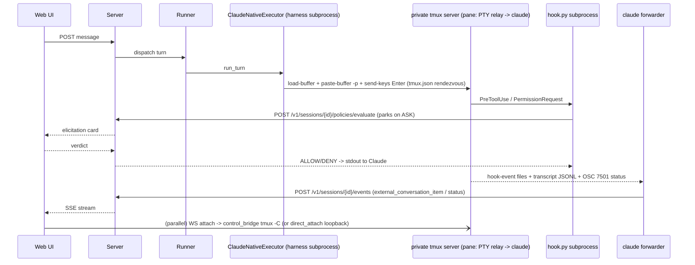

# Omnigent HARNESSES + tmux — Research Report (2026-11-09 update)
> Produced 2026-11-09 by a read-only Claude research subagent (one of five parallel passes) updating the 2026-08-18 tmux/native-wrappers report. Method: read current code at commit b03ad1ac9, compared against the baseline report. Citations are file:line at that commit.

Scope: how each harness runs (native TUI-in-tmux, native server, SDK, CLI subprocess, ACP), how transcripts and events come back, how approvals and policy hooks flow, and whether tmux is still coordination or just a multiplexer. Labels: **NEW / CHANGED / REMOVED / UNCHANGED** vs `docs/research/2026-08-18-tmux-native-wrappers.md`. All paths are relative to `apps/omnigent`. There are 3,544 commits between the last commit on or before 2026-08-18 (`036e0b9d2`) and HEAD.

## 0. TL;DR

- **CHANGED (layout):** the flat `omnigent/*_native*.py` modules now live in per-harness packages `omnigent/harnesses/<name>_native/{main,bridge,forwarder,hook,permissions,...}.py`. This came from the 2026-09-08 package regrouping (`54a947de7`, #6721). Shared native code lives in `omnigent/native/`, and runner-side launch lives in `omnigent/runner/native/orchestration.py` (11,493 lines).
- **NEW:** there is now a declarative capability registry. Every harness declares `integration_mode` (one of `SDK_IN_PROCESS`, `CLI_SUBPROCESS`, `ACP_SUBPROCESS`, `NATIVE_TUI`, `NATIVE_SERVER`), its elicitation style, resume behaviour, and more (`omnigent/harness_capabilities.py:24-31`, table at `omnigent/harness_plugins.py:356-758`). The baseline's taxonomy is now code, not inference.
- **NEW harnesses:** `devin-native` (2026-09-15), plus ACP CLI catalog rows `grok` and `jcode` (`omnigent/acp_cli_harnesses.py:94,112`). **REMOVED:** the built-in `devin-acp` row (0.14). The name survives only as an alias to `devin-native` (`harness_plugins.py:833-841`).
- **CHANGED (verdict):** tmux is still essential, but the input-injection part of its role has narrowed. Four native harnesses no longer type web turns into the pane:
  - codex-native uses app-server JSON-RPC `turn/start` / `turn/steer`.
  - opencode-native uses REST.
  - pi-native uses an extension inbox.
  - qwen-native uses `--input-file`.

  For them, tmux only hosts and shares the real TUI. Seven still inject with `send-keys` / `paste-buffer`: claude, cursor, devin, goose, hermes, kimi, and kiro. Antigravity makes an eighth: it reads over connect-RPC but still writes via tmux.
- **REMOVED:** the PTY-fork web-attach transport `terminals/ws_bridge.py` (`ecf9d6475`, 2026-08-25, #5484). Browser attach is now tmux control mode only (`terminals/control_bridge.py`).
- **NEW:** a same-machine direct-attach listener (`runner/direct_attach.py`), a minimum tmux version of 3.3 (`util/tmux_compat.py:9`), an OSC 7501 program-status PTY relay inside the pane (`terminals/program_status.py`, `inner/terminal.py:1701-1711`), and an owner-claim orphan reaper for private tmux servers (`inner/terminal.py:895`).

## 1. tmux inventory: what changed

| Mechanism | Status | Evidence |
|---|---|---|
| One private tmux server per terminal (`mkdtemp(...)/tmux.sock`), session `"main"`, `-f /dev/null` | UNCHANGED | `inner/terminal.py:2842-2843`, `:1181-1183`, `:1594-1605` |
| tmux ≥ 3.3 required (for `allow-passthrough`). Fails with coded `TmuxUnavailableError` | NEW | `util/tmux_compat.py:9-70`, `inner/terminal.py:834-845`, `:2838` |
| `remain-on-exit on` + `exit-empty off` | CHANGED: now opt-in per terminal (`keep_alive_after_exit`). The runner turns it on for native panes. Rationale: issue #540, so a CLI crash doesn't take the socket with it | `inner/terminal.py:122-186`; `runner/native/orchestration.py:3032,5139,9918` |
| Liveness via `list-panes #{pane_dead}`. `has-session` is used only to confirm "gone" | UNCHANGED (more diagnostics) | `inner/terminal.py:2482-2515`, `:2588-2660`, `:1451-1470` |
| Orphan sweep of `omnigent-terminal-*` dirs with `kill-server`, keyed on `owner.pid` plus PID namespace and boot id | NEW | `inner/terminal.py:895-960`; `native/owner_claim.py:15-20` |
| Buffer-paste (`load-buffer` + `paste-buffer -p`) still duplicated in each harness | UNCHANGED (still not centralized) | claude `harnesses/claude_native/bridge.py:4763`; cursor `:811`; devin `:1352`; hermes `:780`; antigravity `:1711`; kiro `:651`; kimi `:975`; goose `:303` |
| Each harness has its own `_run_tmux` helper | UNCHANGED | e.g. `harnesses/claude_native/bridge.py:5946`, `devin_native/bridge.py:1013`, `qwen_native/bridge.py:750` |
| Web attach via forked `tmux attach` on a PTY (`ws_bridge.py`) | REMOVED | `git log`: `ecf9d6475` "remove PTY web attach transport" |
| Web attach via control mode `tmux -C attach`, input via `send-keys -H` | UNCHANGED, now the only path | `terminals/control_bridge.py:1-30`, `:689` |
| Read-only viewers no longer attach with `-r`. Input is dropped at server and runner instead, because on tmux 3.7 `-r` blocked the harness's own `send-keys` | CHANGED | `server/routes/terminal_attach.py:48-54`; CHANGELOG v0.16 #8949 |
| Probe of which terminal queries tmux itself answers, so xterm.js replies are not double-typed | NEW | `terminals/query_replies.py:1-20` |
| Loopback direct attach (browser to runner on 127.0.0.1, bearer token, owner-only) that skips the server relay | NEW (file dates 2026-08-13; not in baseline) | `runner/direct_attach.py:1-30` |
| OSC 7501 program-status relay wrapping the pane command (claude-native working/blocked state; flag `CLAUDE_OSC_STATUS`, on by default) | NEW | `terminals/program_status.py:1,241`; `inner/terminal.py:1701-1711`; `server/feature_flags.py:163-170`; `harnesses/claude_native/program_status.py:1` |
| `OMNIGENT_TMUX_SOCK` stripped from the pane env; socket deny-listed by the sandbox | UNCHANGED | `inner/terminal.py:767-773`, `:2916` |
| Idle native-pane reaper: busy if a turn is active, the PTY watcher says running, or there was recent human input; uses tmux's activity clock | CHANGED (stricter "busy" rule) | `terminals/pane_reaper.py:1-28`; CHANGELOG v0.10 #4577 |
| Cost-approval `display-popup` | UNCHANGED | `native/native_cost_popup.py` |
| `pipe-pane` | still ABSENT | grep finds no hits |
| Windows | UNCHANGED: native terminals are refused | `inner/terminal.py:2832-2837` |

**Split panes and grids (v0.20 and v0.21) do not use tmux.** No managed terminal uses `split-window`. The only hits are in the outer-REPL helper at `cli.py:14408-14412`. The web "split terminal view" (flag `splittable_terminal_view_ui`) is a browser layout over separate terminal resources, and each resource has its own private tmux server (`web/src/shell/TerminalSplitControls.tsx:50-83`, `web/src/shell/terminalSplitPanesStore.ts`). Session grids (#10948 and follow-ups) are likewise web-side.

## 2. Harness table (registry at `harness_plugins.py:356-758`, module routing `:808-832`)

| Harness | Kind | Process model | Turn input path | Event/transcript path back | Approvals / policy | tmux? | vs baseline |
|---|---|---|---|---|---|---|---|
| claude-native | NATIVE_TUI | `claude` TUI in runner-owned private tmux; hook subprocesses; MCP relay | tmux paste-buffer + `send-keys Enter` (`claude_native/bridge.py:4450-4691`) | forwarder tails hook-event files and Claude's JSONL; OSC 7501 status | HOOK: `--settings` hooks (`bridge.py:3028`) → `/policies/evaluate` + PermissionRequest (`claude_native/hook.py:1047,1143`) | yes (input + host) | UNCHANGED core; status relay NEW |
| codex-native | NATIVE_TUI (TUI is a `--remote` client) | runner starts `codex app-server --listen` (`codex_native/app_server.py:2455`); TUI in tmux runs `codex --remote ws://…` (`:5792-5799`) | JSON-RPC `turn/start` / `turn/steer` (`inner/codex_native_executor.py:291-294,754`) | forwarder holds a second JSON-RPC subscription | JSONRPC elicitation + PreToolUse hook in a private `CODEX_HOME` (`codex_native/hook.py:1-10`) | host/share only | CHANGED: input is RPC, not keys |
| opencode-native | NATIVE_SERVER | runner-owned `opencode serve` on 127.0.0.1 with a random password; TUI in tmux uses `--server --session` (`opencode_native/app_server.py:1-25,277-281`) | REST `send_prompt` (`opencode_native/http_transport.py:224`) via `NativeServerHarness` (`native/native_server_harness.py:46`) | SSE forwarder | SSE_PERMISSION | host/share only | UNCHANGED |
| pi-native | NATIVE_TUI | `pi` TUI in tmux with a generated Omnigent extension | JSON files dropped in an inbox dir; extension calls `pi.sendUserMessage` (`pi_native/bridge.py:218`; `inner/pi_native_executor.py:30-40`) | extension and Pi session dir | the extension POSTs policy on `tool_call` | host only | baseline silent |
| qwen-native | NATIVE_TUI | `qwen` TUI in tmux with `--input-file` / `--json-file` | append JSONL `submit` to the input file (`qwen_native/bridge.py:1-24,590`); Escape via tmux for interrupt | tail the `--json-file` NDJSON | APPROVAL_MIRROR via `confirmation_response` in the input file | host + interrupt | CHANGED (file inject) |
| antigravity-native | NATIVE_TUI | `agy` TUI in tmux; connect-RPC on ephemeral loopback TLS port | tmux paste (`inner/antigravity_native_executor.py:1-25,289-292`) | RPC read driver polls `GetCascadeTrajectorySteps` (`antigravity_native/reader.py:1-30`); replaced a transcript tail | RPC `HandleCascadeUserInteraction` (`antigravity_native/interactions.py:1-15`); declared `NONE` | yes | CHANGED (read side is RPC) |
| devin-native | NATIVE_TUI | `devin` TUI in tmux; session-scoped `--config` with hooks | tmux paste (`devin_native/bridge.py:1-20,1368`) | `hooks.jsonl` tail + ATIF export + read-only `sessions.db` for subagents (`devin_native/forwarder.py:1-27`) | HOOK through the shared `native_policy_hook` (`devin_native/hook.py:1-25`) | yes | NEW |
| cursor-native | NATIVE_TUI | `cursor-agent` TUI in tmux | tmux paste (`cursor_native/bridge.py:1-9,770`) | poll `~/.cursor/chats/.../store.db` (`cursor_native/forwarder.py:1-25`) | APPROVAL_MIRROR: detect pending call in `store.db`, keystrokes deliver the verdict (`cursor_native/permissions.py:1-17`) | yes | UNCHANGED |
| goose-native | NATIVE_TUI | `goose session --name <sid>` in tmux | tmux paste (`goose_native/bridge.py:261`) | poll Goose `sessions.db` | APPROVAL_MIRROR: `capture-pane` scrape, then drive the selector (`goose_native/permissions.py:1-16`) | yes (input + approvals) | UNCHANGED |
| hermes-native | NATIVE_TUI | `hermes` TUI in tmux | tmux paste (`hermes_native/bridge.py:807`) | poll `$HERMES_HOME/state.db` | APPROVAL_MIRROR via `capture-pane` | yes | UNCHANGED |
| kimi-native | NATIVE_TUI | `kimi` TUI in tmux with a private `KIMI_CODE_HOME` | tmux paste (`kimi_native/bridge.py:837`) | tail `wire.jsonl` | HOOK: `config.toml [[hooks]]` → `/policies/evaluate` (`kimi_native/hook.py:1-16`) | yes | UNCHANGED |
| kiro-native | NATIVE_TUI | `kiro` TUI in tmux | tmux paste (`kiro_native/bridge.py:667`) | tail `~/.kiro/sessions/cli` JSONL (`kiro_native/session_forwarder.py:1-7`) | APPROVAL_MIRROR via "TUI ACP recorder" (`kiro_native/permissions.py:1`) | yes | UNCHANGED |
| claude-sdk | SDK_IN_PROCESS | `claude-agent-sdk` inside a per-conversation harness subprocess (`runtime/harnesses/process_manager.py:560`) | SDK call | SDK message stream → ExecutorEvents | Omnigent tools bridged as MCP | no | UNCHANGED |
| codex | CLI_SUBPROCESS | one long-lived `codex app-server` per session (`inner/codex_executor.py:1-6`) | app-server JSON-RPC | same | JSONRPC; Omnigent tools as `dynamicTools` | no | UNCHANGED |
| openai-agents, copilot, cursor, antigravity, open-responses | SDK_IN_PROCESS | vendor SDK in the harness subprocess | SDK | SDK stream | in-process tools / policy phases | no | UNCHANGED |
| pi | CLI_SUBPROCESS | `pi --mode rpc` JSONL over stdio (`inner/pi_executor.py:1-12`) | stdio | stdio | tools proxied over local TCP | no | UNCHANGED |
| kimi, hermes | CLI_SUBPROCESS | a CLI process per turn (`kimi -p … stream-json`; `hermes chat -q --resume`) | argv | stdout JSONL | hermes: `pre_tool_call` hook | no | UNCHANGED |
| acp, goose, qwen | ACP_SUBPROCESS | ACP JSON-RPC over stdio (`inner/acp_executor.py`, `goose_executor.py`, `qwen_executor.py`) | `session/prompt` | `session/update` | SSE_PERMISSION (ACP request_permission) | no | UNCHANGED |
| grok, jcode | ACP_SUBPROCESS (catalog rows) | generic `acp_harness` + `AcpExecutor`; `grok agent stdio` / `jcode acp` (`acp_cli_harnesses.py:94-122`) | ACP | ACP | inherits the `acp` profile (`harness_plugins.py:761-762`) | no | NEW (not in baseline) |
| devin-acp | — | — | — | — | — | — | REMOVED (0.14) → alias to devin-native |

Native count: the baseline said "ten". The registry now lists 12: eleven `NATIVE_TUI` plus one `NATIVE_SERVER` (`harness_plugins.py:859-887`). The net-new one is devin-native. pi-native already existed (its file dates to 2026-06-15) but the baseline didn't call it out.

## 3. One native turn (claude-native, the representative tmux-input case)

The codex-native difference: the `E->>T` arrow becomes `E->>app-server: turn/start` (JSON-RPC). The TUI in tmux is just another `--remote` client of the same thread, so the pane echoes the turn without any keystrokes.

## 4. Structured event plane (UNCHANGED in shape)

Forwarders still POST `external_conversation_item` and `external_session_status` events to the server. They never route those events through tmux. What changed is the variety of sources, which the baseline only knew as "file tail vs Codex WS":

- hook JSONL: claude, devin
- vendor JSONL: claude transcript, kiro, kimi `wire.jsonl`, qwen `--json-file`
- vendor SQLite polling: cursor `store.db`, goose, hermes, devin subagents
- vendor RPC: codex app-server, antigravity connect-RPC
- SSE: opencode

Shared plumbing:

- `native/_native_post_delivery.py`, `_native_forwarder_health.py`, `_native_supersession.py`
- `native/native_dispatch.py:1-12`: lazy resolution of `NativeHarnessProvider` hooks, which replace `if harness == "x"` branches (`harness_plugins.py:84-113`)
- the runner's `/events` control hub `runner/native_controls.py:1-5`, which handles model, effort, compact, and cost-popup events

The claude bridge module also hosts the **shared `serve-mcp` relay** used by Codex, Antigravity, OpenCode, Cursor, Hermes, Kiro, Qwen, and ACP clients (`harnesses/claude_native/bridge.py:1-6`). The module name is historical.

## 5. Approvals and policy: the four `Elicitation` styles (`harness_capabilities.py:34-41`)

1. **HOOK** (claude, devin, kimi; codex also registers a hook): the vendor runs a hook subprocess, which POSTs to `/policies/evaluate`. On ASK the server parks the POST until a human answers, then returns a hard ALLOW/DENY. Translation is shared in `native/native_policy_hook.py:1-18`, with a cache in `native/policy_allow_cache.py`. The devin docs note that deny is honoured even under `--permission-mode bypass` (`harness_plugins.py:525-531`).
2. **JSONRPC** (codex-native, codex): app-server approval requests are mirrored to web elicitations (`codex_native/elicitation.py`).
3. **APPROVAL_MIRROR** (cursor, goose, hermes, kiro, qwen): detect the TUI's own approval prompt and post it to the generic `native-permission-request` hook, which parks. Detection varies: `capture-pane` scraping for goose and hermes, the `store.db` pending part for cursor, the input-file protocol for qwen. The verdict is delivered back as keystrokes into the pane, except for qwen. **This is the second place where tmux is still load-bearing for coordination.**
4. **SSE_PERMISSION** (opencode, ACP family): protocol-native permission events.

## 6. Verdict: is tmux still coordination?

**Yes, but less than in August, and the trend points toward "PTY host + multiplexer".**

- Still coordination:
  - (a) sole input path for 7 of 11 TUI harnesses, plus antigravity's writes;
  - (b) keystroke delivery of approval verdicts for APPROVAL_MIRROR harnesses;
  - (c) `capture-pane` scraping for approval detection and input readiness (`native/input_ready.py:1-8`);
  - (d) interrupt/Escape and slash commands for most TUIs;
  - (e) a security boundary (socket deny-list, env strip).
- Now just host/multiplexer: codex-native, opencode-native, pi-native, and qwen-native for input. Their turn traffic goes over RPC, REST, or files, and tmux only keeps the real TUI alive and lets many viewers attach. The control-mode-only web attach, direct attach, browser-side split panes, and grids are all multiplexing features layered on top.
- The "device follows you" continuity (private server + `remain-on-exit` + multi-client attach) is UNCHANGED and still requires tmux for every native harness, including NATIVE_SERVER opencode. Every `*_native/main.py` still preflights `shutil.which("tmux")` (e.g. `codex_native/main.py:1600`, `devin_native/main.py:1000`), and the runner refuses to start without tmux 3.3+.
- SDK/CLI/ACP harnesses never touch tmux, except through the agent-granted `sys_terminal_*` tools (`tools/builtins/sys_terminal.py`).

## 7. Baseline uncertainties resolved

- The "taxonomy vs mechanism" question for plain `codex` `WARM_REATTACH`: it is app-server thread resume. It is a long-lived `codex app-server` per session (`inner/codex_executor.py:1-6`), with no PTY.
- The "daemon that owns the runner": that is `omnigent/host/` (`daemon_lifecycle.py`, `service.py`, `runner_zygote.py`). Located, but not traced in this pass.

## Uncertainties

- The per-harness `_run_tmux` / paste implementations were located by grep, not diffed. Whether they diverge in subtle ways (bracketed paste, chunking, verification) is unverified.
- `inner/antigravity_native_executor.py` disagrees with itself. Its module docstring (`:1-25`) and the code path (`:289-292`) say "TUI injection over tmux", but the `run_turn` docstring (`:204-213`) still says it delivers via the `SendUserCascadeMessage` RPC. I trust the code (tmux). `rpc.send_user_cascade_message` (`rpc.py:781`) appears to have no executor caller.
- antigravity-native declares `Elicitation.NONE` (`harness_plugins.py:445`) even though `interactions.py` bridges agy WAITING asks to Omnigent elicitations. The capability row may be stale.
- How pi-native's 7 live deltas stream is flagged as untraced in the code itself (`harness_plugins.py:387-393`). Not resolved here.
- `runner/native/orchestration.py` (11.5k lines) and `harnesses/claude_native/bridge.py` (11.5k lines) were read only at the call sites cited. Cold-resume, warm-reattach, and supersession flows were not re-traced.
- The claim that split panes and grids are web-only rests on the absence of `split-window` in managed-terminal code and a skim of two web files. The grid "shared workspace" server side was not read.
- Whether the OSC 7501 relay wraps panes other than claude-native's: `program_status_app` is a generic `TerminalInstance` field (`inner/terminal.py:1122`), but I found consumers only in claude-native.
- Cross-replica SSE fan-out (a baseline uncertainty) was not re-examined. It is outside this pass's scope.
