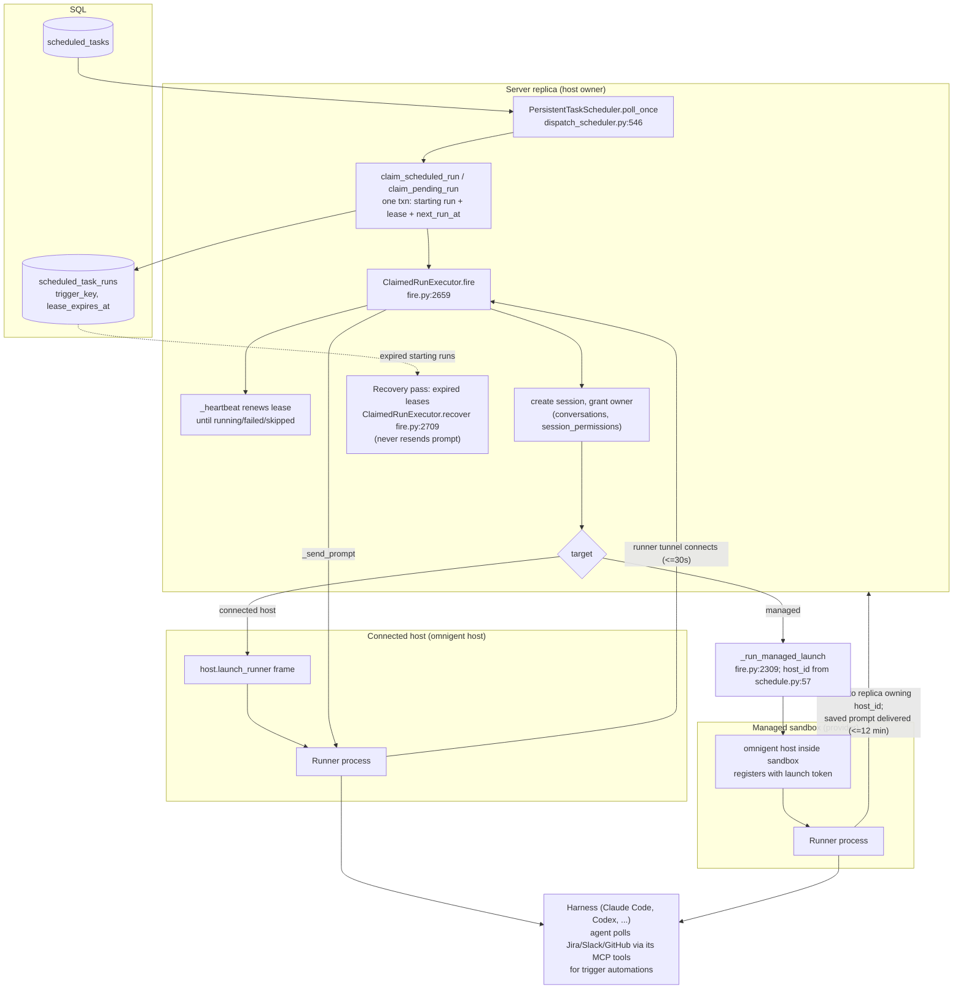

# Omnigent — Subsystems New Since July 2026 — Research Report (2026-11-09)
> Produced 2026-11-09 by a read-only Claude research subagent (one of five parallel passes) extending the 2026-08-18 corpus. Method: CHANGELOG v0.7–v0.21 to find candidates, confirmed in code at commit b03ad1ac9. Citations are file:line at that commit.

Scope: subsystems that the 2026-08-18 corpus (written against v0.4–v0.6, July 2026) does not cover, or
covers only as a file name. "July" below means the tree at `de8c38f68` (last commit before 2026-07-22).
Line counts are `wc -l` at HEAD; "July → now" counts compare the two trees.

How the candidates were picked: keyword counts over CHANGELOG.md (automation 46, sub-agent 88,
bundle 48, managed sandbox 20, pull request 27, smart routing 13, side chat 24, ...), then a check
of the baseline corpus. The baseline mentions none of scheduled tasks, automations, pull requests,
side chats, harness accounts or grids, and lists `smart_routing.py` / `bundles.py` by name only.

## Summary table

| # | Subsystem | Owning tier | Main code (lines) | Persistence | New or grown |
|---|---|---|---|---|---|
| 1 | Automations v2: persistent dispatch + trigger automations | server | `server/scheduled/` (5,664), `routes/scheduled_tasks.py` (1,180) | `scheduled_tasks`, `scheduled_task_runs` | v1 timers from 2026-07-16; DB dispatcher from 2026-10-22 |
| 2 | Session orchestration: peer messaging, sibling families, side chats | server (gate) + runner (tools) | `session_orchestration.py` (128), `session_families.py` (184), `subagent_activity.py` (352), `child_session_recovery.py` (329) | `omnigent_conversation_metadata.family_id`, conversation labels | 2026-09-17 → 2026-11-06 |
| 3 | Server-owned session pull requests | server owns, runner/host reports | `session_pull_requests.py` (390), `stores/session_pull_request_store.py` (636), `runner/pr_reports.py` (165) | `omnigent_conversation_metadata.pull_requests` (JSON) | 2026-10-27 |
| 4 | Managed sandbox lifecycle (profiles, keep-alive, reaper, more providers) | server | `managed_hosts.py` (2,385 → 5,093), `managed_sandbox_reaper.py` (285), `managed_host_keepalive.py`, `sandbox_profiles.py` (522), `onboarding/sandboxes/` (15,670) | `hosts` row (durable identity), conversation labels (profile snapshot) | grown; reaper/keepalive 2026-09-04, profiles 2026-10-30 |
| 5 | MCP registry + gateway | server | `mcp_registry.py` (453), `mcp_gateway.py`, `mcp_policy_adapter.py` (129), `registry_gateway.py` (117) | credential store (existing), YAML config | 2026-10-13 |
| 6 | Smart routing v2 | server | `smart_routing.py` (641 → 2,549), `routing_backend.py` (299) | in-memory workspace-scoped cache | grown 4x |
| 7 | Harness accounts + custom agent catalog | host probes, server caches/stores | `harness_accounts.py` (52), `onboarding/harness_accounts.py` (337), `bundles.py` (179 → 422), `cli.py:12585` | host hello frame (in memory); `agents` table + artifact store | 2026-08 → 2026-10 |

Smaller additions are listed in "Other notable additions" below.

---

## 1. Automations v2: persistent dispatch and trigger automations

**What it is.** An automation (DB name: scheduled task) is a saved prompt plus an RFC 5545 RRULE.
Each occurrence starts, or continues, an agent session on a connected host or a managed sandbox.
July had an in-memory timer scheduler (`scheduled/scheduler.py`, 371 lines, still the default).
Since October, the flag `automations_v2` turns on a **database-backed, multi-replica-safe
dispatcher**. It works with claims, leases and recovery.

**Where it lives.**
- `omnigent/server/scheduled/dispatch_scheduler.py` (1,125). `PersistentTaskScheduler` is at `:418`, poll loop `poll_once` at `:546`, `_claim_due` at `:865`, `_heartbeat` at `:1092`, `_recover` at `:738`. `StartupLease` is at `:157`, `FireIdentityRevoked` at `:371`.
- `omnigent/server/scheduled/fire.py` (2,857). `ClaimedRunExecutor` is at `:2636`, with `fire` at `:2659` and `recover` at `:2709`. Constants: `_RUNNER_CONNECT_TIMEOUT_S = 30.0` at `:140` and `SANDBOX_REGISTRATION_TIMEOUT_S = 12 * 60` at `:186`.
- `omnigent/server/scheduled/schedule.py` (102): trigger keys, sandbox host-id derivation (`:57-81`) and `is_trigger_automation` (`:96`).
- Store protocol: `stores/scheduled_task_store/dispatch.py:18` (`ScheduledTaskDispatchStore`: `list_due_tasks :59`, `claim_scheduled_run :63`, `claim_pending_run :105`, `renew_starting_run :116`, `list_expired_starting_runs :126`). SQL implementation: `sqlalchemy_store.py:1270-1480`.
- REST: `routes/scheduled_tasks.py`. It has `POST/GET /scheduled-tasks` (`:618`, `:732`), a failure inbox `GET /scheduled-tasks/inbox` (`:765`), run history (`:815`), Run now `POST .../run` returning 202 (`:901`), and PATCH/DELETE (`:958`, `:1160`).
- The design doc in the package is long and current: `server/scheduled/README.md` (854 lines, with mermaid lifecycle diagrams) and `EXAMPLES.md`.

**Persistence.** `scheduled_tasks` (`db/db_models.py:1567`). New columns since July include
`next_run_at`, `project_id`, `delegation_ref` (an "opaque grant reference, never credentials"),
`session_mode` (`:1636`, new or continue) and `host_id` (`:1623`).
`scheduled_task_runs` (`:1690`) gained `trigger_key` (`:1692`) and `lease_expires_at` (`:1700`).
A **claim** is one transaction. It inserts a `starting` run with a lease and advances
`next_run_at`, so only one replica wins an occurrence (README "How a poll works").

**Tier and plug-in points.** This is server-only. The executor does no new transport work. It reuses
the July session machinery:
- Connected host: `resolve_host_launch` → `_launch_runner_on_host` → `_wait_for_runner_client` → `_send_prompt` (`fire.py:2099-2133`). This is the same `host.launch_runner` frame and runner tunnel a UI-created session uses.
- Managed sandbox: the prompt is saved on the session, then `_run_managed_launch` (`fire.py:2309-2330`) starts a sandbox under a host id derived from the task (`schedule.py:57-63`). The prompt is delivered by whichever replica holds that sandbox's tunnel.
- Multi-replica: `owned_hosts` (`ScheduledTaskDispatchHooks`, `dispatch_scheduler.py:391`) decides which replica claims for which host. Embedding deployments inject it, plus `fire_identity`, `on_fire` and `on_expired`, through `create_app` (`app.py:1657`, `:2128-2151`).
- App wiring: the flag is read at `app.py:1813`. The legacy `ScheduledTaskScheduler` or the `PersistentTaskScheduler` is built at `app.py:2120-2151`.

**Trigger automations (Jira, Slack, GitHub, Linear, PagerDuty).** These are **not webhooks**.
A trigger is a `session_mode=continue` task whose prompt starts with a fixed template sentence
(`schedule.py:87-101`: "This automation watches {source} and starts one Omnigent session").
The dispatcher re-polls it every 2 minutes (`TRIGGER_POLL_SECONDS`), skips the poll while the
session is busy (`build_busy_until`, `fire.py:444`), and the *agent* polls the source with its own
MCP tools. The web form warns when those tools are missing (CHANGELOG #12084, line 308). Detection
is by prompt prefix, mirrored in `web/src/components/scheduled/triggerTemplates.ts`.

**Governance hooks.**
- An agent that creates or updates a task through `sys_scheduled_task_create/update` (`tools/builtins/scheduled_tasks.py`, 400 lines) always gets a mandatory approval. The rule `ask_on_scheduled_task_change` is installed into every policy engine (`policies/builtins/safety.py:392-395`, review text at `:460-514`).
- On the server side, a request from a runner must prove it came from the owner's own session and bound runner (`routes/scheduled_tasks.py:325-360`, `X-Omnigent-Orchestration-Source`).

---

## 2. Session orchestration: peer messaging, sibling families, side chats

**What it is.** Sessions can now talk to *other top-level sessions*, not only to their own child
sub-agents. There are four related pieces:
- **Peer messaging.** The `sys_session_message` builtin (`tools/builtins/session_message.py:14`, added 2026-10-26) lets a session send work to another session with the same owner. The runner forwards it as a `session_message` event to `POST /v1/sessions/{id}/events` with the `X-Omnigent-Orchestration-Source` header (`runner/session_message.py:34-36`, header defined at `runner/identity.py:17`).
- **Server gate.** `require_orchestration_source` (`server/session_orchestration.py:80-112`) requires four things: the `session_orchestration` flag, a *private* sending session owned by the caller, a runner tunnel token bound to that session's `runner_id`, and the same owner on the target. The message is wrapped as `[Message from session X]`. The code says that prefix is a display label, "not proof of message origin" (`:115-128`). Automations use the same path (CHANGELOG #11851).
- **Sibling families.** `session_families.py` (added 2026-11-06) runs behind the `sibling_sessions` flag (`:41`). It groups independent "worker" sessions created from a source session. Persistence is `omnigent_conversation_metadata.family_id` (`db_models.py:717`, index `:760`), plus a per-user pinned label (`family_pinned_label_key`, `stores/conversation_store/__init__.py:190`). The host launch path checks `family_id` (`routes/hosts.py:1120`, `:1304`), so siblings can share or split compute.
- **Side chats.** These are child conversations marked with labels `omnigent.side_chat` and `omnigent.side_chat.source_id` (`stores/conversation_store/__init__.py:133-136`). Most of the logic is in `harnesses/codex_native/side_chat.py` (542 lines). The server checks at `routes/sessions/routes_core.py:1018` whether a side chat is allowed.
- **Durable sub-agent links.** `subagent_activity.py` (2026-09-30) parses `<task-notification>` blocks from native harnesses into parent-chat links (`:27-30`). `child_session_recovery.py` (2026-09-17) restarts interrupted child sessions after the parent initializes.

**Tier.** Policy and authorization are on the server. Tools run on the runner. Delivery reuses the
existing session-event API, so there is **no new transport**. The July `parent_conversation_id` /
`root_conversation_id` columns (`db_models.py:888-892`) still model parentage. Peer messages
deliberately "don't change parentage or forward replies" (`session_message.py` description).

---

## 3. Server-owned session pull requests

**What it is.** The session's Pull Requests tab now reads a server-side list, so it works while
the host is offline. The module docstring (`server/session_pull_requests.py:1-11`) states the split:
the runner or host "is the only forge client". It reports the PRs it finds, and the server owns
which PRs belong to the session.

**Flow.**
1. The runner records PRs in `SessionPrRegistry` and sends them as `external_pull_requests` session events. It keeps resending with backoff until the server returns a 2xx (`runner/pr_reports.py:1-9`, `EVENT_TYPE :26`).
2. The server merges reports idempotently into one compressed JSON document on `omnigent_conversation_metadata.pull_requests` (`db_models.py:721`). Limits are 50 PRs and 50 unlinks per session (`stores/session_pull_request_store.py:45-46`). Relationship ranks are `inferred < worked_on < attached < created` (`:43`, `:55`). An unlinked PR stays unlinked.
3. `vouch()` (`session_pull_requests.py:164`) names a PR to the host so the host fetches details even for a PR it never recorded.
4. `PullRequestRefresher` (`:274`) refreshes from the runner or host 5 s after a turn ends and at most every `FRESHNESS_S = 300` s per listed session (`:43`). It is installed at app start (`app.py:1919`, `:2222`).
5. REST: `GET/DELETE /sessions/{id}/pull-requests` (`routes/sessions/routes_resources.py:3504`, `:3537`).

Forges are pluggable: `omnigent/git_providers/{github,gitlab,azure_devops}.py`.

---

## 4. Managed sandbox lifecycle

Managed sandboxes existed in July (`managed_hosts.py`, 2,385 lines, and providers modal, daytona,
cwsandbox, islo, e2b, openshell, boxlite and kubernetes from June). The baseline describes only the
launch-token handshake. What changed:

- **Durable host identity.** The `hosts` row keeps the identity, and each relaunch writes a new sandbox *generation* under the same `host_id`. Session bindings therefore survive a sandbox that the provider killed at its lifetime cap (`managed_hosts.py:11-15`). The file has grown to 5,093 lines.
- **New providers:** blaxel (2026-08-10), agent_sandbox plus a warm pool (09-04, 09-17), microsandbox (09-06), gensee (09-11), databricks_sandbox (10-21) and lambda_microvm (11-09). All are under `onboarding/sandboxes/` (15,670 lines in total). Arclet/Arca appear only as provider *names* in schemas (`server/schemas.py:2140`) and as UI flags (`ARCA_SHUTDOWN_WARNINGS`). Their launcher appears to be injected by an embedding deployment through the `ManagedSandboxConfig` launcher factory (`managed_hosts.py:24-28`).
- **Keep-alive.** The runner reports `keep_warm` on each tunnel pong (`runner/busy_check.py:10-11`, `runner/_entry.py:2084-2097`). `managed_host_keepalive.touch` (`:230`) turns that into provider `keep_alive` calls. Its docstring notes that nine providers implemented `keep_alive` but only the CLI had been calling it (`:1-28`).
- **Reaper.** `ManagedSandboxReaper` (`managed_sandbox_reaper.py:31`) sweeps stale or pending provider generations in keyset pages. It "detaches only the stale provider generation"; the transcript and host row are kept (`:32-43`). It starts at `app.py:2207-2220`.
- **Sandbox profiles** (flag `sandbox_profiles`, 2026-10-30). Provider-discovered profiles are listed at `GET /sandbox-profiles` (`routes/sandbox_profiles.py:25`). An **immutable** snapshot is bound to the session in server-owned conversation labels (`stores/sandbox_profile_store.py:24-26`, `:97-123`).
- **Sandbox inference.** `routes/sandbox_inference.py` (2026-09-18) previews which models a managed sandbox can reach and validates saved session policies.

---

## 5. MCP registry and gateway

**What it is.** An administrator lists approved remote MCP services in YAML (`OMNIGENT_MCP_REGISTRY`,
`mcp_registry.py:130-158`). Users connect their own account per service, and credentials go into
the existing per-user credential store (`:1`, `:27`). The server then **executes MCP tool calls
itself** at `POST /mcp/{service_id}` (`routes/mcp_gateway.py:16-20`):
- `McpPolicyAdapter` (`mcp_policy_adapter.py:35`) applies session authorization and Omnigent policies.
- `McpGatewayBackend` (`mcp_gateway.py:11`) is the "session-independent execution contract". A deployment can replace it through `app.state.mcp_gateway_backend` (`app.py:2302`).
- Management routes are under `/mcp-registry/services[...]` (`routes/mcp_registry.py:37-112`).

**Why it matters architecturally.** In July all MCP execution happened on the runner, through
`McpServerConnection` (`tools/mcp.py`). For registry services the server is now a **tool-execution
tier** with user OAuth tokens that never reach the host. It reuses the sessions route's
`_handle_mcp_tools_call` (`mcp_policy_adapter.py:20`).

---

## 6. Smart routing v2

`smart_routing.py` grew from 641 to 2,549 lines, and `routing_backend.py` (299) is new.
Routing is per call:
- `select_router` (`routing_backend.py:92`) picks an external `RoutingClient` when the call's harnesses are AI-Gateway-backed. Otherwise it uses the built-in `LLMRoutingClient` (`smart_routing.py:556`), which prompts the server LLM with a capability rubric (`_build_rubric :530`) and has "no tier abstraction" (`:1-11`).
- `route_with_fallback` is at `routing_backend.py:129`.
- Model candidates now come from the **runner's live catalog** (`fetch_runner_models :460`, `prefetch_runner_catalog :333`, cached per workspace). Per-family ladders are defined in `models/model_fallbacks.py` and imported at `smart_routing.py:24-34`.

The server therefore pulls model lists from runners. July routing used a static, harness-inferred list.

---

## 7. Harness accounts and the custom agent catalog

- **Harness accounts.** The host probes local CLIs (codex, claude, pi, opencode) for non-secret account metadata: kind, email, org, plan, expired (`onboarding/harness_accounts.py:17-18`). It sends this in the host hello frame and through the `host.probe_harness_accounts[_result]` frames (`host/frames.py:89`, `:244-245`). The data is normalized to a wire-safe shape (`harness_accounts.py:13-52`). The server caches it on the `HostConnection` with a probe timestamp (`server/host_registry.py:216-219`, `:543`) and re-probes only on request (`:966-984`). Nothing about accounts is persisted.
- **Custom agents.** `omnigent agent add SOURCE` (`cli.py:12585-12600`) accepts a directory, YAML file, `.tar.gz` bundle, or GitHub `owner/repo[/path][@agent]`. It uploads to the server so the agent appears in the picker on every host. It uses the July `agents` table and artifact store, with `bundles.py` growing from 179 to 422 lines (`uploaded_agent_id`). The Settings management UI is behind the `custom_agents_settings_ui` flag.

---

## Other notable additions (brief)

- **Feature-flag registry.** `server/feature_flags.py:23-42` defines 17 `OMNIGENT_FEATURES` keys, each with an owner and a `review_by_release`. Most new subsystems ship behind one: `automations_v2`, `sandbox_profiles`, `session_orchestration` (default on), `sibling_sessions`, `peer_session_messaging`, `grid_sessions_display_ui`, `canvas`. A per-request kill switch for automations also exists (`automations_availability.py`, 20 lines, 2026-11-05).
- **Builtins.** `web_read` (`tools/builtins/web_read.py`, 354 lines, 2026-10-06) uses Jina/Nimble/Firecrawl backends and needs an explicit `read_provider`. There are also many more `web_search_*` backends.
- **Spec.** A top-level `tool_groups:` block opts out of framework tool groups (`spec/parser.py:315-317`).
- **Policies.** `PolicyEvent` gained `conversation_id` and `conversation_name` (CHANGELOG #8467, #10065), and compiled CEL programs are cached (#10101).
- **Projects.** A `projects` table (`db_models.py:788`, added 2026-07-22) stores a compressed `config`. Automations can file their sessions into a project (`scheduled_tasks.project_id`).
- **Web client.** New `web/src/grid` (session grids) and `web/src/canvas`. Android, iOS and Electron shells **already existed in July** (51, 49 and 53 files); they have grown to 128, 99 and 196 files. They are not new tiers.

---

## What July-era mental model is now wrong

1. **"The server is a passive relay/store; runners do the work."** The server now runs at least four background engines: the persistent scheduler with lease recovery, the PR refresher, the managed-sandbox reaper, and keep-alive. It also *executes* MCP tool calls for registry services (§5) and calls runners to fetch model catalogs (§6).
2. **"One server process."** The automation dispatcher, sandbox host-id derivation, and "deliver on the replica that holds the tunnel" all assume **several replicas**, coordinated through DB claims and host ownership (`owned_hosts`). Wrong-replica forwarding also appears in runner tools (`runner/session_message.py:37`).
3. **"Sessions only start from a human (UI/CLI) or as a child sub-agent."** Sessions now also start or continue from automations, from peer sessions (`sys_session_message`), and from sibling and side-chat creation. Parent/child (`parent_conversation_id`) is no longer the only relation: there is also `family_id`, side-chat labels, and the peer "source" header.
4. **"A managed sandbox is the host."** The host identity is a durable `hosts` row, and sandboxes are disposable *generations* under it that get reaped, relaunched and kept warm (§4).
5. **"Session state lives on the runner; the server stores the transcript."** The server now keeps forge state (PR membership, cached titles and states) and immutable sandbox-profile snapshots in session metadata and labels, so the UI works with the host offline.
6. **"Integrations (Jira/Slack/GitHub) are server-side webhooks."** Trigger automations are *polling prompts* executed by the agent with its own MCP tools. The only server involvement is the 2-minute re-poll and the busy-skip logic. (The Slack *bot* is a separate integration daemon, `integration_daemon.py`.)
7. **"Features are on when merged."** Much of the new surface is behind `OMNIGENT_FEATURES` flags, and `automations_v2` is **off by default** (README line 17). A default deployment still runs the July in-memory timers.

## Uncertainties

- I read docstrings, signatures and wiring, not every branch. The behavioral claims about the scheduler (2-minute trigger re-poll, 12-minute sandbox timeout, recovery never resending) come mostly from `server/scheduled/README.md` plus the constants I spot-checked. I did not trace them end to end.
- Arclet/Arca: no launcher implementation was found in this repo, only provider names in schemas and UI. My conclusion that a deployment injects it through the launcher factory is an inference.
- I did not determine which parts of side chats are Codex-only and which apply to every harness. The main implementation is under `harnesses/codex_native/`, but the labels and server checks are harness-neutral, and Claude-native side-chat fixes appear in the CHANGELOG (#9602).
- `server/routes/_sessions/orchestration.py` (14,187 lines) is session-route orchestration (relay, fork/switch, MCP calls). It is not agent-to-agent orchestration, and it is left to the server re-survey pass.
- Smart-routing claims (per-call backend choice, runner catalog) are based on module docstrings and function names. I did not verify the fallback ordering.
- First-commit dates come from `git log --diff-filter=A`. A file renamed from older code would look newer than it is.
- I did not query the `kielay-index` for prior research on these topics before writing. Overlap with the other four parallel passes (server, host/runner, harnesses, class map) is expected, especially for §4 and §6.
