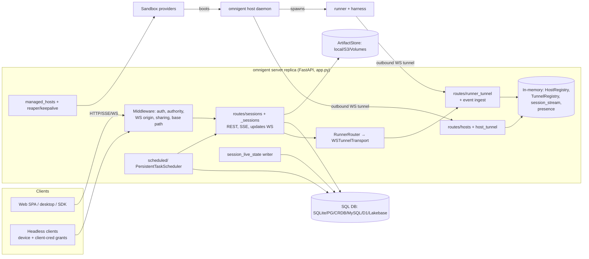

# Omnigent SERVER — Research Report (2026-11-09 update)
> Produced 2026-11-09 by a read-only Claude research subagent (one of five parallel passes) updating the 2026-08-18 report. Method: read current code at commit b03ad1ac9, compared against the baseline report. Citations are file:line at that commit.

Baseline: `docs/research/2026-08-18-server-subsystem.md` (July 2026 code, v0.4–0.6). Today: v0.22.0.dev0, 6,206 commits in history, last commit 2026-11-09.
Change tags: **NEW** / **CHANGED** / **REMOVED** / **UNCHANGED** are relative to the baseline.

## 1. Headline changes since the baseline

1. **CHANGED: the server is now built to run as several replicas.** It shards by `host_id`. Each replica holds only its own tunnels. A request that reaches the wrong replica gets `400 wrong_replica` (`server/app.py:1772-1778`, `ErrorCode.WRONG_REPLICA` raised at `routes/_sessions/common.py:1084`). Tunnels can be handed between replicas (CHANGELOG #10409, #9719). Live sidebar state is now written to the DB so any replica can serve it (`server/session_live_state.py:1-25`). The baseline described one process with in-memory registries.
2. **CHANGED: `sessions.py` (~21.8k lines) was split up.** There is now a `routes/sessions/` package of 11 files (19,116 lines) and a `routes/_sessions/` helper layer of 3 files (28,315 lines: `helpers.py` 12,746, `orchestration.py` 14,187, `common.py` 1,382). The sessions code grew about 2.2x in total.
3. **NEW: runner→server push channel, called "event ingest".** The runner tunnel now has an additive capability, `session-event-ingest-v1`. With it the runner pushes `EventBatchFrame`s and the server answers with `EventAckFrame` (`runner/transports/ws_tunnel/frames.py:212-241`; handled at `routes/runner_tunnel.py:658,899-990`; wired at `server/app.py:3831-3833`). This replaces the baseline claim that every frame except `runner_exited` is a reply to a server request.
4. **NEW: persistent, multi-replica scheduler for automations.** It sits in `server/scheduled/` (5,664 lines). `PersistentTaskScheduler` (`scheduled/dispatch_scheduler.py:418`) uses DB claims and leases. The older in-memory `ScheduledTaskScheduler` (`scheduled/scheduler.py:99`) still exists. The `automations_v2` flag picks between them (`scheduled/README.md`; lifespan `app.py:2087-2201`).
5. **NEW: server-launched cloud sandboxes, called "managed hosts".** `server/managed_hosts.py` is 5,093 lines. It uses sandbox providers in `omnigent/onboarding/sandboxes/`: Modal, E2B, Daytona, Kubernetes, Databricks, Blaxel, Lambda microVM and others. Supporting pieces are a reaper (`managed_sandbox_reaper.py`) and a keepalive (`managed_host_keepalive.py`).
6. **NEW auth surfaces:** the OAuth device grant (RFC 8628; `routes/device_auth.py`, `device_grant_store.py`), the client-credentials grant (`routes/client_credentials.py`), per-user third-party connections with KMS-encrypted secrets (`connections` table), and the accounts→OIDC identity migration (`identity_migration.py`).
7. **CHANGED DB:** there are 5 new tables (`preferences`, `connections`, `device_grants`, `projects`, `conversation_labels`) plus 2 scheduler tables. The `agent_configuration` table is gone. CockroachDB is supported (`db/cockroachdb.py`). There are 122 Alembic revisions.

## 2. Module inventory (154 `.py` files, ~115k lines under `omnigent/server/`)

| Path | Lines | Responsibility | Tag |
|---|---|---|---|
| `server/app.py` | 5,533 | `create_app()` (`:1566`), `_lifespan` (`:1936`), `FastAPI(...)` (`:2278`), middleware, mounting about 45 routers, SPA static mount (`:5324`) | CHANGED (was ~1.4k at the cited lines) |
| `cli.py` `server` command | — | Process entrypoint, `def server(` at `cli.py:4687`, calls `create_app(` at `:5118` | CHANGED (baseline cited `:2916`) |
| `host/local_server.py` | 1,299 | Same pidfile supervisor that spawns the identical server on loopback | UNCHANGED in role (was 906 lines) |
| `server/schemas.py` | 5,837 | Pydantic request/response models | CHANGED (was 4,066) |
| `routes/sessions/` (11 files) | 19,116 | `/v1/sessions*`: core CRUD and list (`routes_core.py` 5,316), events and SSE (`routes_events.py` 4,294), resources (`routes_resources.py` 4,314, 47 endpoints), harness hooks (`routes_hooks.py` 2,146), items, agent, permissions, browser, elicitations, UI | CHANGED (split) |
| `routes/_sessions/` (3 files) | 28,315 | Helpers split out of `sessions.py`: SSE item builders, persistence, runner relay (`orchestration.py:9013 _relay_runner_stream`), fork/switch, MCP calls | NEW (as a layer) |
| `routes/codex/sessions.py` | 716 | `/sessions/{id}/codex_goal*` (`:477-666`) | NEW |
| `routes/hosts.py` | 2,487 | 18 endpoints: hosts, runners launch (`:1079`), host filesystem, harness login, install, credentials, worktrees | CHANGED (grew) |
| `routes/host_tunnel.py` | 1,470 | `WS /v1/hosts/{host_id}/tunnel` (`:225`) | CHANGED |
| `routes/runner_tunnel.py` | 1,160 | `WS /v1/runners/{id}/tunnel` (`:430`), `GET /runners` (`:302`), status (`:333`), `POST token` (`:367`), event ingest | CHANGED |
| `routes/terminal_attach.py` + `_runner_ws_tunnel.py` | 537 + 321 | Browser xterm WS (`terminal_attach.py:136`) multiplexed over the runner tunnel as `ws.open`/`ws.frame`/`ws.close` channels. NEW: a direct-attach resolver (`_runner_ws_tunnel.py:115`) gives same-machine browsers an attach URL that skips the relay | CHANGED |
| `host_registry.py` | 1,002 | Per-replica in-memory map of live host connections. The `hosts` table is the cross-replica truth (`:1-16`, class `:607`) | CHANGED (replica-aware) |
| `omnigent/runner/routing.py` `RunnerRouter` | 491 | Conversation → bound runner → httpx client over `WSTunnelTransport`. Tells WRONG_REPLICA apart from RUNNER_UNAVAILABLE (`app.py:1893-1906`) | NEW (as a named component) |
| `runner/transports/ws_tunnel/` | 5,464 | `TunnelRegistry` (`registry.py:240`), `WSTunnelTransport` (`transport.py:107`), frames, `event_delivery.py` (new) | CHANGED |
| `scheduled/` (13 files) | 5,664 | RRULE (bounded), dispatch scheduler, fire (2,857), run reconciler, telemetry. Routes in `routes/scheduled_tasks.py` (1,180; 9 endpoints `:618-1160`) | NEW |
| `managed_hosts.py`, `managed_sandbox_reaper.py`, `managed_host_keepalive.py`, `sandbox_profiles.py`, `inference_catalog.py`, `routes/sandbox_*` | ~7k | Provisioning and lifecycle of cloud sandboxes running `omnigent host` | NEW |
| `smart_routing.py` (2,549) + `routing_backend.py` (299) | — | Model routing. Uses an external Databricks Unity Gateway `task_v1` router or a built-in LLM judge, with fallback (`routing_backend.py:1-13`) | CHANGED (backend selection is new) |
| `auth.py` (948), `oidc.py` (540), `oidc_access.py`, `accounts_*.py`, `passwords.py`, `routes/auth.py` (1,669), `routes/accounts_auth.py` (881), `routes/_auth_helpers.py` | — | Identity, covered in §5 | CHANGED |
| `routes/device_auth.py` (1,086), `device_grant_store.py` (647), `routes/client_credentials.py` (566) | — | Delegated tokens for headless clients (Slack is the first consumer) | NEW |
| `connections_registry.py`, `routes/connections_{base,github,databricks}.py`, `github_app*.py`, `databricks_app*.py` | — | Per-user third-party integrations and a sandbox credential broker | NEW |
| `mcp_pool.py`, `mcp_gateway.py`, `routes/mcp_gateway.py`, `mcp_registry.py`, `routes/session_mcp_servers.py` (779), `mcp_policy_adapter.py` | — | Server-side MCP proxy with policy enforcement, an admin MCP registry, and a managed MCP gateway | CHANGED (registry and gateway are new) |
| `dictation.py` (725), `routes/dictation.py` | — | `WS /v1/dictation/stream` (`routes/dictation.py:109`), on-server speech-to-text | NEW |
| `presence.py` | 343 | Who-is-viewing registry, 15 s leave grace (`:67`), in-memory only | UNCHANGED (behaviour) |
| `session_live_state.py` (500), `startup_inputs.py` (647), `child_session_recovery.py`, `background_session_titles.py`, `session_pull_requests.py`, `session_families.py`, `subagent_activity.py` | — | Session lifecycle and display state that must survive a replica change or restart | NEW |
| `performance_metrics.py` (1,166), `feature_flags.py` (`OMNIGENT_FEATURES`), `sharing_settings.py` (file-backed), `ws_origin.py`, `graceful_shutdown.py`, `shutdown_state.py` | — | Operations | mostly NEW |
| `routes/imports.py` (824) | — | Import of local harness transcripts | NEW |
| `routes/projects.py`, `preferences.py`, `comments.py`, `sharing.py`, `usage.py`, `builtin_agents.py`, `skills.py`, `plugins.py`, `extensions.py` | — | Smaller CRUD surfaces | mixed |

**Middleware** (`app.py`): `_WebSocketMetricsMiddleware` (`:2601`), `WebSocketOriginMiddleware` (`:2606`), an http request middleware (`:2628`), `AccountAuthenticationMiddleware` (accounts mode, `:5134`), `AccountAuthorityMiddleware` (`:5344`), `PublicSharingPolicyMiddleware` (`:5345`), `BasePathMiddleware` (subpath proxy, `:5351`), and range-aware gzip on the SPA (`:5326`). **There is still no `CORSMiddleware`** (grep found none). UNCHANGED.

App-level endpoints: `/health` (`:3326`), `/api/version` (`:3399`), `/.well-known/omnigent.json` (`:3411`), `/v1/info` (`:3505`), `/v1/me` (`:3737`).

## 3. Route inventory (selected; most are mounted with prefix `/v1`)

| Path | Method | file:line | Tag |
|---|---|---|---|
| `/sessions` | POST / GET | `routes/sessions/routes_core.py:1052` / `:2079` | CHANGED location |
| `/sessions/orchestrated` | POST | `routes_core.py:1035` | NEW |
| `/sessions/{id}` | GET / PATCH / DELETE | `routes_core.py:1922`, `:3053`, `routes_events.py:4071` | CHANGED location |
| `/sessions/{id}/fork`, `/labels`, `/auto-title`, `/agent-title`, `/model-override/reset` | POST/GET | `routes_core.py:4197,2010,2961,2912,3020` | NEW (except fork) |
| `/sessions/updates` | **WS** | `routes_core.py:2594` | UNCHANGED path; now also driven by per-user `runtime/user_session_stream.py` (NEW) |
| `/sessions/{id}/events` | POST | `routes_events.py:1053` | UNCHANGED contract: persist first, then forward (invariant I1, `routes/sessions/__init__.py:10-14`) |
| `/sessions/{id}/stream` | GET **SSE** | `routes_events.py:3877` | UNCHANGED contract: snapshot plus live tail, no replay |
| `/sessions/{id}/items`, `/child_sessions`, `/side_chats` | GET | `routes_items.py:78,137,324` | NEW (side chats) |
| `/sessions/{id}/hooks/*` (permission, codex/antigravity/cursor/native elicitation, pi-extension-ui, route-subagent, route-turn), `/policies/evaluate` | POST | `routes_hooks.py:263-1941` | NEW: harness hook callbacks into the server |
| `/hosts/{id}/tunnel` | **WS** | `routes/host_tunnel.py:225` | CHANGED (baseline `:121`) |
| `/runners/{id}/tunnel` | **WS** | `routes/runner_tunnel.py:430` | CHANGED (baseline `:344`) |
| `/sessions/{id}/resources/terminals/{tid}/attach` | **WS** | `routes/terminal_attach.py:136` | UNCHANGED (path) |
| `/dictation/stream` | **WS** | `routes/dictation.py:109` | NEW |
| `/scheduled-tasks[...]` incl. `/inbox`, `/{id}/runs`, `/{id}/run` | CRUD | `routes/scheduled_tasks.py:618-1160` | NEW |
| `/projects[...]` | CRUD | `routes/projects.py:66-183` | NEW |
| `/oauth/device/*`, `/oauth/token`, `/oauth/revoke` | GET/POST | `routes/device_auth.py:457-928` | NEW |

## 4. Persistence — system of record

**Engines (CHANGED):** SQLite (default; FTS5), PostgreSQL via psycopg, Databricks Lakebase (token refresh, `db/utils.py:86-195`), **CockroachDB (NEW**, `db/cockroachdb.py`, URL rewrite `db/utils.py:212-224`, serialization-retry `:1058`), MySQL (deadlock-retry `:1059`), and Cloudflare D1 (`_FTS5_DIALECTS`, `db/utils.py:1229`). Access is still synchronous SQLAlchemy run through `asyncio.to_thread`. No async driver was found. UNCHANGED. There are still two bases, `OmnigentBase` (`db_models.py:93`) and `ConversationBase` (`:104`). Every table's PK still leads with `workspace_id`.

| Table | file:line | Notes | Tag |
|---|---|---|---|
| `agents` | `db_models.py:196` | bundle bytes live in the ArtifactStore | UNCHANGED |
| `files` | `:266` | metadata only | UNCHANGED |
| `users` | `:329` | shared by the accounts and permission stores. Holds generation IDs and deletion tombstones (`accounts_store.py:1-5`) | CHANGED |
| `preferences` | `:351` | per-user settings | NEW |
| `account_tokens` | `:398` | invite and magic tokens. The token is still the row `id`, stored **verbatim** (not hashed) | UNCHANGED |
| `connections` | `:456` | per-user integrations; `secret_enc` is AWS-KMS ciphertext (`:427-445`) | NEW |
| `device_grants` | `:528` | RFC 8628 grants; secrets hashed before lookup (`device_grant_store.py:18-19`) | NEW |
| `session_permissions` | `:593` | ACL | UNCHANGED |
| `omnigent_conversation_metadata` | `:665` | Runtime snapshot. New columns: `inference_snapshot`, `git_branch`, `runner_last_seen`, `live_status`, `pending_elicitation_count`, `background_work_*`, `blocked_on`, `project_id`, `family_id`, `pull_requests` (JSON doc, `stores/session_pull_request_store.py:1-12`), `side_chat_parent_id` | CHANGED (much wider) |
| `projects` | `:788` | owner-private session grouping | NEW |
| `conversations` | `:874` | added `session_overrides`, `archived`. **`agent_configuration` is REMOVED as a table** (see migrations `b7e4d2c9a1f3_merge…`, `bb2c3d4e5f6a_split…`) | CHANGED |
| `conversation_items` | `:989` | position-ordered log, see note below | CHANGED |
| `conversation_labels` | `:1102` | key/value labels. Also carries sandbox-profile references (`stores/sandbox_profile_store.py:1-20`) and scheduled-task origin | NEW |
| `comments`, `policies`, `hosts`, `user_daily_cost` | `:1157,1259,1386,1475` | `hosts` added `token_expires_at`, `sandbox_provider`, `sandbox_id`, `terminating_sandbox_id`, `deleted_at`, `configured_harnesses`, `account_generation` | CHANGED (hosts) |
| `scheduled_tasks`, `scheduled_task_runs` | `:1567,1690` | runs carry claim and lease state | NEW |
| `conversation_items_fts` | `db/utils.py:1217-1254` | FTS5 on SQLite/D1 only | UNCHANGED |

**Item log is no longer strictly append-only.** Positions are still allocated under a row lock (`with_for_update`, `stores/conversation_store/sqlalchemy_store.py:1052,1856`). But a *pending-input* placeholder row is now deleted and replaced at the same position (`:3170-3187`), and subtree deletes remove items (`:6774`). Item bodies still have no UPDATE path. CHANGED.

**Non-DB state:**
- ArtifactStore backends: local, S3, Databricks volumes (`stores/artifact_store/*`). UNCHANGED.
- Sharing settings and the admin roster are **plaintext files** in the data dir (`sharing_settings.py:1-8`). NEW.
- In-memory per replica: `HostRegistry`, `TunnelRegistry`, `presence`, the `session_stream` mailboxes, and `user_session_stream`.
- Compression: `db/compression.py` is now 152 lines (was 59). `CompressedText` is referenced 21 times in `db_models.py`, so many more than the baseline's 6 opaque columns use it. CHANGED.
- `p1a2b3c4d5e6_remove_all_fks.py` still exists, so the app still does all cascades itself. UNCHANGED.

**System of record:** the server DB is authoritative for conversations, items, labels, ACLs, hosts, scheduled runs, projects, connections and preferences. **CHANGED:** display state that the baseline called "in-memory, dies with process" (runner online, turn status, pending approvals) is now *also* written best-effort, in order, to the metadata row. The goal is that any replica can answer (`session_live_state.py:1-25`). It is display state, not authority. The tunnel-holding replica's caches stay the synchronous source.

## 5. Auth

- Modes are still `header` / `oidc` / `accounts` (`auth.py:5-17`). **CHANGED:** with no explicit `OMNIGENT_AUTH_PROVIDER`, the server resolves to `header`, unless `OMNIGENT_AUTH_ENABLED` is truthy. Then it uses `oidc` if `OMNIGENT_OIDC_ISSUER` is set, otherwise `accounts` (`auth.py:341-381`). The docstring says the Docker entrypoint turns on accounts mode by default (`auth.py:330-332`). Session cookie: `__Host-ap_session` on HTTPS, **`ap_session` on plain HTTP** (NEW, `auth.py:555`), HS256 (`:676`).
- **NEW:** local single-user mode with a loopback-exposure warning (`auth.py:220-283`).
- **NEW:** account "generations". Deleting an account revokes its authority across replicas (`db/account_authority.py:1-7`; CHANGELOG #7642).
- **NEW:** the device grant is mounted only in accounts and standard-OIDC modes when `OMNIGENT_DEVICE_GRANT_ENABLED` is set. It can be gated by `OMNIGENT_DEVICE_CLIENT_SECRET` (`routes/device_auth.py:24-40`). A client-credentials grant gives a machine principal a path-scoped token.
- **Host tunnel auth** (`host_tunnel.py:225-360`). It still runs before `ws.accept()` (`:361`). A managed-host token must resolve, with no fallback to user auth; otherwise the close code is 4004 (`:266-280`). Without a managed token, the user identity comes from `auth_provider.get_user_id`. There is a cross-owner `host_id` collision check. Tokens are still stored only as SHA-256 (`stores/host_store.py:193-205`). **NEW:** tokens now have a TTL, `token_expires_at`, and are renewed. **Resolved baseline gap:** tokens are minted at `managed_hosts.py:4075,4431,4821` and registered via `HostStore.register_managed_host` (`host_store.py:1137`).
- Runner tunnel: the token header is `RUNNER_TUNNEL_TOKEN_HEADER` with `token_bound_runner_id` (`routes/runner_tunnel.py:25`). UNCHANGED in concept.

## 6. How the server talks to hosts, runners and clients

- **Hosts:** outbound WS from the host. The host sends `host.hello` with readiness, then *unprompted* readiness updates, `host.runner_exited`, and harness-login-completed frames (`host_tunnel.py:1-12,845-990`). The protocol version check is strict on the major version. The server still never dials a host. UNCHANGED in direction, wider frame set.
- **Runners:** outbound WS. The server sends framed HTTP requests through `RunnerRouter` → `WSTunnelTransport`. The session relay (`_relay_runner_stream`, `routes/_sessions/orchestration.py:9013`) holds a long-lived GET of the runner's SSE. It persists items and republishes to `runtime/session_stream.py`. It rides out drops within `RUNNER_DISCONNECT_GRACE_S`. **NEW:** the event-ingest push (`EventBatchFrame`/`EventAckFrame`), with per-session locks and slots (`runner_tunnel.py:899-913`). **NEW:** a runner can shut itself down when idle, using the close reason `"runner idle shutdown"` (`frames.py:216-217`).
- **Clients:** SSE per session. `runtime/session_stream.py` (618 lines, was 108) now gives each subscriber a **bounded mailbox of 1024 events**. A slow subscriber is disconnected rather than buffered without limit (`:1-24,54`). CHANGED. Delivery is still at-most-once with no replay. The `WS /sessions/updates` stream gained a per-user `session_added` push (`runtime/user_session_stream.py:1-23`).
- **Outbound from the server (NEW):** cloud sandbox provider APIs, the Databricks Unity Gateway and LLM judge for routing, the GitHub App, AWS KMS, and MCP servers through the pool and gateway.
- `server/_runner_transport.py` `build_uds_runner` (Unix-socket runner) is only referenced from tests (`tests/server/test_runner_transport.py`, `tests/test_scheduled_context.py`). The tunnel looks like the only production path.

## 7. Baseline claims re-checked

| Baseline claim | Status |
|---|---|
| `sessions.py` ~21.8k lines, ~60 endpoints | **Stale.** The file is gone. Sessions routes are split across 2 packages, about 47k lines and 90+ decorators. |
| `create_app` `app.py:1063`, lifespan `:1231`, `FastAPI` `:1383` | **Stale lines.** Now `:1566`, `:1936`, `:2278` |
| `cli.py:2916` server command | **Stale.** Now `cli.py:4687` |
| No CORSMiddleware | **Holds** |
| `/health/subscribe` WS missing | **Still missing.** Only `GET /health` (`app.py:3326`) |
| session_stream drops events with no subscriber | **Holds**, now with bounded per-subscriber queues |
| presence 15 s grace, never persisted | **Holds** (`presence.py:67`) |
| `account_tokens` stored verbatim | **Holds** |
| host token SHA-256 only | **Holds**, plus expiry |
| `agent_configuration` table | **Removed** |
| items append-only | **Mostly.** Pending placeholder rows are replaced; deletes happen on subtree removal |
| Server never connects to host/runner; only `runner_exited` is unprompted | **Partly stale.** Still no server-initiated dial. Unprompted frames now include host readiness/login events and runner event batches |
| Single-process in-memory registries are authoritative for liveness | **Stale.** Multi-replica host sharding; live state mirrored to the DB |
| Header mode is the default | **Holds in code.** Deployments (Docker) flip to accounts via `OMNIGENT_AUTH_ENABLED` |

## Uncertainties

- I did not read the Docker entrypoint, so the claim that accounts mode is on by default in Docker rests only on the docstring at `auth.py:330-332`.
- I did not trace how the external router or load balancer applies `host_id` sharding (header name, NGINX/K8s example in CHANGELOG #9637). I saw only the server side (`app.py:1772-1778`, `configure_host_sharding`).
- I did not read the order of the `agent_configuration` merge and split migrations. "Removed" means only that today's `db_models.py` has no such table. Where its fields went (probably `conversations.session_overrides`) is unconfirmed.
- I counted endpoints with decorator greps, not full handler reads. Counts like "90+" and "about 45 routers" are approximate.
- I read event-ingest semantics only at the frame and wiring level. I did not verify whether ingest replaces the SSE relay for capable runners or runs alongside it.
- The provider list for managed sandboxes comes from filenames in `onboarding/sandboxes/` and string literals in `managed_hosts.py`. I did not check which providers are actually production-ready.
- I did not open the `scheduled/` lease and recovery details beyond the README terminology table, or `fire.py` (2,857 lines).
- I read `smart_routing.py`, `dictation.py`, `mcp_gateway`/`mcp_registry`, and `routes/imports.py` only at docstring level.
- I did not re-check the baseline's `designs/OBSERVABILITY.md:424` "durable event log" note. The new event-ingest path may be a partial implementation of it, but that is unconfirmed.
- I did not count the compressed columns individually. "21 references" counts `CompressedText` usages in `db_models.py`, not distinct columns.
